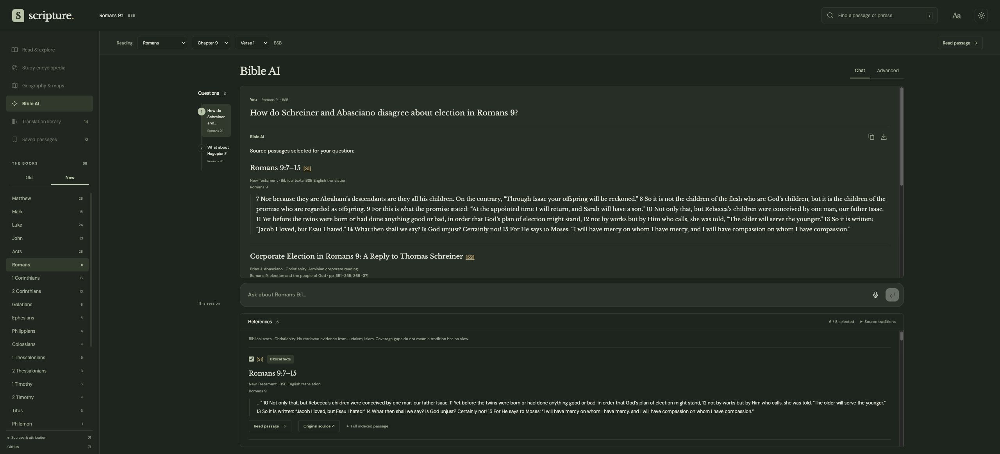
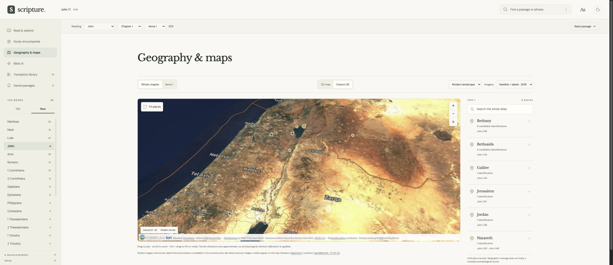

# Scripture

A Bible reader and study workspace built with **Svelte 5**: compare translations,
explore Hebrew and Greek, follow places through 2D and 3D maps, and research named
sources across Christian traditions, Judaism, and Islam.

**[Open Scripture](https://tjkoury.com/bible/)** ·
[Run locally](#run-locally) ·
[Data and sources](#data-and-sources) ·
[Local AI quality](docs/local-ai-quality.md) ·
[Training documentation](docs/training-small-model.md)



## A workspace anchored to your reading

The current book, chapter, and verse carry through the reader, verse study,
geography, encyclopedia, and Bible AI. You can follow a reference without
rebuilding your context, or ask an explicit research question about another passage.

| Area | What you can do |
| --- | --- |
| **Reader** | Read 14 installed English editions; compare translations; search text and references; save passages; adjust text size; switch between light and dark themes. |
| **Original languages** | Inspect WLC Hebrew/Aramaic and SBLGNT Greek with MACULA lemmas, morphology, contextual glosses, and Strong’s identifiers. Follow a lemma through the corpus. |
| **Verse study** | Explore ranked cross-references, preserve verse ranges, and open linked people, places, and objects. Saved verses have a filled bookmark and a visible saved-passage count. |
| **Geography** | Switch between MapLibre 2D and CesiumJS 3D, change imagery, and inspect alternative place identifications in expandable candidate lists. |
| **Encyclopedia** | Read attributed Wikipedia material grouped into history, archaeology, artifacts, maps, other literature, and references where available. |
| **Bible AI** | Type or dictate a question, inspect exact source extracts, and revisit previous questions through the session timeline. No tradition is designated the preferred interpretation. |

### Bible AI

Bible AI opens with an empty question field in a separate rounded input panel.
Submitting a question retrieves evidence; suggested questions are not submitted
automatically. The main conversation and references share the same width and
scroll independently.
A narrow timeline in the margin keeps each question’s reading context, sources,
and result together for the current session.

Optional voice dictation uses the browser's speech-recognition support to fill
the question field. It starts only at your request after you enable dictation;
review the transcription before submitting it yourself.
Unsupported browsers retain typed input. [Speech-recognition support varies and
may use a browser-provider service](https://developer.mozilla.org/en-US/docs/Web/API/SpeechRecognition);
dictation is separate from the local WebGPU model.

The **Advanced** tab holds device checks, model downloads, cache controls, the
source inventory, and training information. Search and source inspection work
without downloading a model. Research notes can be copied or downloaded as Markdown.

### Geography and landscape evidence



One toolbar contains passage scope, the centered **2D / Cesium 3D** switch, and
landscape and imagery controls. Available layers are:

- **Streets** — OpenStreetMap.
- **Topographic** — OpenTopoMap.
- **Satellite · 2016** — the EOX Cloudless mosaic.
- **Satellite + labels · 2016** — the same mosaic with EOX/MapServer labels.

Imagery selection persists in the browser. Changing a layer preserves the selected
place and camera; selecting a candidate highlights its location. Provider credits
remain visible, and tiles load on demand. Satellite imagery is dated, not live.
Modern elevation comes from Mapterhorn.

The reconstruction lab records dated landscape evidence separately from modern
terrain. Its registry covers all 1,342 atlas places, but currently only four place
records link to a dated study, and **no ancient shoreline, river, or building
geometry has been imported**. The Galilee elevation screening is an uncalibrated
experiment on modern terrain. See [landscape evidence and limits](docs/ancient-landscape-evidence.md).

## Run locally

Use **Node.js 22.12+ or a supported newer release**. **Python 3.13** is recommended
for data tools, the complete test suite, and model packaging; it matches CI.
Model training has separate dependencies.

```sh
git clone https://github.com/TJKoury/bible.git
cd bible
npm ci
npm run dev
```

Open **http://127.0.0.1:4173/**. Vite uses a strict port. The installed scripture
and study data are included in the repository; no Bible API key is needed.
Models download separately when requested.

```sh
npm run check         # Svelte and TypeScript diagnostics
npm test              # Python and Node tests
npm run verify:data   # Scripture, concordance, and download integrity
npm run verify:study  # Geography and encyclopedia integrity
npm run build         # Production build in dist/
```

For the same URL prefix as the public site:

```sh
BASE_PATH=/bible/ npm run build
BASE_PATH=/bible/ npm run preview -- --port 4174
```

## Local AI

The default browser model is **Qwen2.5 1.5B Instruct**, quantized for WebLLM:
about **880 MB of model data**, plus runtime assets, with an estimated
**2+ GB of GPU memory** required.
Its model revision is pinned in [`src/lib/ai.js`](src/lib/ai.js). Download size
and runtime memory are different; the app checks the device before offering a load.

Inference runs in a Web Worker on **WebGPU**. A secure context—HTTPS or
localhost—and `shader-f16` support are required. Open **Bible AI → Advanced**
to inspect compatibility and load, cancel, unload, or remove a cached model.
Questions and selected evidence are not sent to a hosted model API. Model files,
runtime assets, map tiles, and external source links still require network requests.
Optional dictation follows the browser's speech-processing and microphone
permissions, and may send audio to its recognition service.

### How answers stay tied to sources

The model’s job is to select relevant source passages. It does not write
free-form theological paraphrases for the answer:

1. Local retrieval finds candidate passages and retains their source metadata.
2. The app builds bounded extracts copied exactly from the indexed text.
3. The model returns only passage IDs through a constrained JSON schema.
4. JavaScript validates the response and rejects malformed output or unknown IDs.
5. The app displays the original extracts, source details, and reference links.
   Editorial summaries are identified separately from original-source quotations.

An empty selection is reported explicitly. Rejected output is not converted into
an apparently supported answer. This prevents model-written quotations and
invented reference IDs from entering the response; it does not guarantee that a
selected extract answers the question or represents an author’s settled position.
An objection, survey, or historical polemic must still be read in context.
The conversation presents evidence for each question; it is not a verified
theological verdict or a complete survey of the relevant traditions. A valid
source ID and an exact quotation do not establish that the source supports a
proposed conclusion.

Follow-up questions can use up to three earlier user questions from the selected
conversation branch to resolve context. Earlier AI responses are not treated as
source evidence. A standalone question or a new explicit passage starts an
independent research context.

See [the local AI quality report](docs/local-ai-quality.md) for the implemented
checks, evaluation cases, and remaining limitations. The [recorded WebGPU
evaluation](docs/local-ai-browser-evaluation.json) preserves actual requests and
outputs, including an omitted source in a multi-author comparison. Its five
development cases are not a certification of accuracy or neutrality.

### Custom training

The earlier **Scripture Qwen3 0.6B** adaptation remains available as an
experimental training artifact, separate from the default instruction model.
Its browser package is about **347 MB**. It was trained locally with MLX QLoRA
on historical texts from Christianity, Judaism, and Islam, then exported for MLC
and WebGPU.

The training objective was next-token prediction, not reviewed theological
question answering. The measured loss improvement did not establish reliable
attribution, source selection, or religious neutrality. The first unsuccessful
run and the later conservative run are documented rather than presented as
evidence of expertise.

```sh
npm run training:prepare       # Source-separated, provenance-tracked data splits
npm run training:encyclopedia  # Separate attributed Wikipedia section export
npm run training:plan          # Validate inputs and write a plan; does not train
```

Actual training, evaluation, quantization, and browser export commands are in
the [small-model training report](docs/training-small-model.md).
The [research data guide](docs/research-data.md) explains rights, splits, and
coverage. Wikipedia was exported separately and was not used in that training run.
Training runs locally through MLX; the browser is the inference runtime.

## Data and sources

These are the counts in the checked-in dataset, not claims of exhaustive coverage:

| Collection | Included |
| --- | ---: |
| English reading editions | 14 |
| Ranked verse cross-references | 344,799 |
| Greek lemmas / Hebrew lemmas | 5,518 / 8,457 |
| Biblical places / candidate identifications | 1,342 / 4,370 |
| Geography verse links | 5,616 across 860 chapters |
| Abridged encyclopedia articles | 792 |
| Historical theological source editions | 13 |
| Historical research passages | 4,465; approximately 1.45 million words |

**Installed translations:** BSB, WEB, KJV, ASV, BBE, Darby, YLT, DRC, Webster,
JPS 1917, Rotherham, Geneva 1599, NHEB, and CPDV. DRC and CPDV contain 73 books;
JPS contains the Tanakh. Whole-edition JSON ZIP downloads include source notices.

NIV, ESV, NLT, NASB, NKJV, CSB, NRSVue, and NET are not installed. The library
links to publisher information; adding them requires an appropriate license or
authorized provider. No text from another edition silently fills an upstream gap.

The theological collection includes named Christian, Jewish, and Muslim authors
with their dates, translators, and historical perspectives. It is a selective
collection of reusable historical editions, not a survey representative of every
community. Contemporary scholarship and many schools within all three religions
remain underrepresented. The [source manifest](public/data/research/manifest.json)
and [coverage guide](docs/research-data.md) describe those gaps.

### Provenance and reuse

| Source | Use in Scripture |
| --- | --- |
| [Scrollmapper](https://github.com/scrollmapper/bible_databases), [Thiago Bodruk](https://github.com/thiagobodruk/bible), [TehShrike WEB](https://github.com/TehShrike/world-english-bible) | English editions, with individual edition notices. |
| [MACULA Hebrew](https://github.com/Clear-Bible/macula-hebrew) and [MACULA Greek](https://github.com/Clear-Bible/macula-greek) | CC BY 4.0 linguistic annotations, with underlying text credits retained. |
| [OpenBible cross-references](https://www.openbible.info/labs/cross-references/) and [geocoding data](https://github.com/openbibleinfo/Bible-Geocoding-Data) | Attributed verse links, place records, candidates, and bibliography. |
| [SIL libpalaso](https://github.com/sillsdev/libpalaso) | Verse-number mappings. |
| [Wikipedia](https://en.wikipedia.org/) | Abridged CC BY-SA 4.0 material with revision and contributor-history links. |
| [Project Gutenberg](https://www.gutenberg.org/) and [CCEL](https://ccel.org/) | Historical research editions with per-source rights and download hashes. |
| [OpenStreetMap](https://www.openstreetmap.org/copyright), [OpenTopoMap](https://opentopomap.org/about), [EOX](https://maps.eox.at/), and [Mapterhorn](https://mapterhorn.com/) | Modern map imagery and elevation, with provider credits. |

[`sources.lock.json`](sources.lock.json) pins scripture source revisions;
[`public/data/sources.json`](public/data/sources.json) records source URLs and
hashes. Geography, encyclopedia, and research manifests retain their own
provenance. Original downloads are cached in the ignored `.cache/` directory.
Wikipedia references are bibliographic pointers: the bodies of linked papers
are not automatically downloaded or licensed for training.

```sh
npm run data
npm run data:geography
npm run data:research
```

These commands reuse cached sources and pinned revisions. Refreshing a source is
an explicit maintenance action; validate the regenerated files afterward.
Dataset licenses and attribution notices are in [`public/licenses/`](public/licenses/).
Public-domain status depends on jurisdiction; KJV Crown rights apply in the UK.

## Architecture

The app is a static Svelte 5 application built by Vite. Reader data comes from
local JSON assets; retrieval and model inference run in separate workers.

| Path | Responsibility |
| --- | --- |
| [`src/App.svelte`](src/App.svelte) | Reading context, navigation, library, search, bookmarks, and preferences. |
| [`src/lib/StudyPanel.svelte`](src/lib/StudyPanel.svelte), [`data.js`](src/lib/data.js) | Original-language study, concordances, verse mapping, and cached data access. |
| [`src/lib/Atlas.svelte`](src/lib/Atlas.svelte), [`MapView.svelte`](src/lib/MapView.svelte), [`Encyclopedia.svelte`](src/lib/Encyclopedia.svelte) | Passage geography, maps, reconstruction evidence, and encyclopedia views. |
| [`src/lib/Research.svelte`](src/lib/Research.svelte) | Bible AI conversation, question history, dictation, evidence selection, and model controls. |
| [`src/lib/research.worker.js`](src/lib/research.worker.js), [`retrieval.js`](src/lib/retrieval.js) | Local indexing, passage retrieval, reference matching, and source diversity. |
| [`src/lib/model.worker.js`](src/lib/model.worker.js), [`grounding.js`](src/lib/grounding.js) | WebLLM inference, constrained passage selection, validation, and exact-text responses. |
| [`scripts/`](scripts/) | Data import, integrity checks, training, model packaging, and build assets. |
| [`tests/`](tests/) | Data, retrieval, grounding, geography, terrain, and device checks. |

### GitHub Pages

[`pages.yml`](.github/workflows/pages.yml) installs dependencies, checks the app,
runs tests, builds, and publishes `dist/` on pushes to `main`. It obtains
`BASE_PATH` from the Pages configuration so workers, data, downloads, and Cesium
assets resolve beneath `/bible/`.

The custom training artifact is stored in a GitHub release rather than Git
history. [`model-release.json`](model-release.json) pins its size and SHA-256;
[`install_browser_model.py`](scripts/install_browser_model.py) verifies and adds
it to `dist/` during deployment. To include that artifact in a local preview:

```sh
BASE_PATH=/bible/ npm run build
python3 scripts/install_browser_model.py
BASE_PATH=/bible/ npm run preview -- --port 4174
```

The default Qwen2.5 model downloads separately when selected. Hardware information
from the development machine is available only through a development endpoint;
the published site uses browser capability checks.

## Scope and limitations

- Hebrew/Aramaic and Greek are study datasets, not selectable reading editions.
  Septuagint, Latin, other world languages, and original-language deuterocanonical
  texts are not installed.
- Native numbering is preserved for JPS, DRC, and CPDV. Automatic comparison,
  language alignment, and exact passage geography are disabled where compatible
  mappings are unavailable.
- Lemma matches and contextual glosses are study aids. The app does not provide
  individual English-word alignment or an exhaustive textual-critical apparatus.
- Place candidates preserve uncertainty. Coordinates may represent regions or
  approximate locations; historical source scores are not current probabilities.
- Encyclopedia sections are abridged and automatically grouped. Archaeological,
  artifact, literature, and theological coverage remain incomplete.
- Bookmarks and preferences are browser-local. Question history lasts for the
  session. Downloadable data and cached models do not make the app an offline PWA.

## License

Application code is licensed under [Apache 2.0](LICENSE). Scripture texts,
annotations, encyclopedia material, maps, and models retain their own licenses.
The application license does not replace those source terms.
